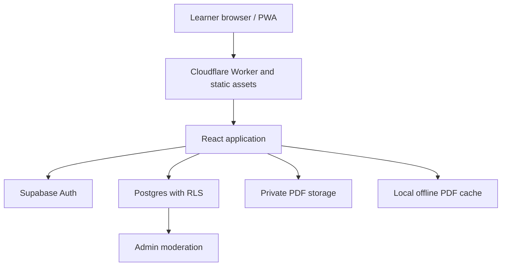

<div align="center">


# NotesHub

### Big ideas. Little notes. Better together.

A calmer corner of the internet to discover, save and share free study notes.

[](https://noteshub.tech)
[](https://noteshub.tech)
[](https://react.dev)
[](https://vite.dev)
[](https://supabase.com)
[](https://workers.cloudflare.com)
[](https://noteshub.tech/install)
[](LICENSE)

**[Community](https://noteshub.tech/community) · [Explore notes](https://noteshub.tech/explore) · [Browse subjects](https://noteshub.tech/subjects) · [Install app](https://noteshub.tech/install) · [Share feedback](https://noteshub.tech/feedback)**

</div>

---

## What is NotesHub?

NotesHub is an independently developed, student-focused learning library for original study notes, revision guides and responsibly shared educational PDFs. It welcomes school, college, professional and independent learners.

Browse and preview approved resources without an account, or sign in to build your own library and contribute notes. A paper-inspired interface combines soft pastel colors, thoughtful typography and light and dark themes.

> NotesHub is live and ready for its initial public launch. As verified on November 27, 2026, the production library contains 58 approved community PDFs, including 50 original introductory revision sheets, plus six built-in sample PDFs. Counts may change over time.

## Version 2.3.0

Version 2.3.0 is merged into main and includes managed subject suggestions, self-hosted DM Sans and Manrope, linting, browser tests and read-only database audits. Pre-merge verification passed 11 unit tests, 7 browser tests, ESLint and npm audits with zero reported vulnerabilities. Production deployment verification and outstanding security and privacy work are tracked in the [release checklist](docs/release-2.3.md).

```sh
npm ci
npx eslint src
node --test scripts/*.test.mjs
npm run build
npm run check
npx playwright install chromium
npx playwright test
node scripts/live-audit.mjs
npm audit
```

## Features

| Discover | Make it yours | Give back |
| --- | --- | --- |
| Search notes and subjects | Bookmarks and collections | Upload original PDFs |
| Filter by course and level | Continue reading | Request study resources |
| Preview and download PDFs | Save selected PDFs offline | Ratings and comments |
| Original sample resources | Install the PWA | Moderated community reviews |

### 1. Open learning library
- Browse approved community notes and original starter PDFs.
- Search and filter by subject, course, learning level and source.
- Preview PDFs before downloading.
- Public subject pages and study guides.

### 2. Personal study space
- Email/password accounts and configurable Google, GitHub and Discord OAuth.
- Personal dashboard, bookmarks, collections and recently viewed notes.
- Continue reading and trending resources when data is available.
- Responsive navigation and profile-menu logout.
- Mobile layout refinements for decorative cards, controls and smaller screens.
- Loading skeletons and related study resources.

### 3. Community contributions
- Upload, edit and submit PDFs for moderation.
- Per-file upload limit of 8 MB.
- Note requests, ratings, comments and reporting tools.
- Admin-only bulk upload of up to 50 PDFs per batch, followed by moderation.
- One-click starter library importer generates 50 original revision sheets across ten IT subjects, with deterministic file paths, retry support and pending moderation.
- Note owners can edit or delete their own notes; admins can moderate, recategorize and delete submissions.
- Contributors must own the material or have permission to distribute it.

### 4. Meet the community

- [Community Contributors](https://noteshub.tech/community) — discover learners with approved public notes.
- Search by public nickname or subject; sort by name, published notes or recorded downloads.
- Individual contributor pages show approved resources and aggregate contribution statistics.
- Optional public nickname in My profile, with a generated initial avatar. No public nickname is required.
- Visible contributor button on note pages and a community link in the footer.
- Private account details are not used as the public directory identity.

### 5. Feedback and moderation
- Five-star ratings, general reviews, app feedback, feature suggestions and bug reports.
- Public reviews require explicit publication consent and administrator approval.
- Public review summaries, rating distribution, sorting and pagination.
- Bug reports and feature suggestions remain private.
- Admin dashboard for moderation, feedback status, publishing, unpublishing and deletion.
- Statistics for approved notes, registered users, eligible signed-in downloads and feedback ratings.

### 6. Progressive Web App
- Install on supported mobile and desktop browsers.
- Service-worker caching for the app shell.
- Save up to 15 approved PDFs for offline access on supported browsers.
- Offline files remain on the device and may be cleared by browser storage management.

### 7. Search visibility and analytics
- Build-generated robots.txt and XML sitemap, with a live approved-note sitemap served by the Worker.
- Public note and subject pages with page-specific metadata, canonical URLs and structured data.
- Permanent redirect from the legacy Workers hostname to the custom domain.
- Optional Google Analytics 4 with opt-in consent and Cloudflare Web Analytics.

---

## Technology stack

| Area | Technology |
| --- | --- |
| Frontend | React 18 |
| Build tool | Vite 6 |
| Routing | React Router 7 |
| Icons | Lucide React |
| Authentication | Supabase Auth |
| Database | Supabase Postgres |
| PDF storage | Supabase Storage |
| Authorization | Row Level Security (RLS) |
| PWA | vite-plugin-pwa, Workbox, Cache Storage |
| Analytics | Google Analytics 4, Cloudflare Web Analytics |
| Hosting | Cloudflare Workers and Static Assets |

## How it works



PDF submissions remain pending until approved. Storage access is governed by database and storage policies, with short-lived signed URLs for permitted reads.

---

## Getting started

### 1. Clone and install

Use a supported Node.js version compatible with the installed dependencies (Node.js 22 or newer recommended), npm and a Supabase project.

```bash
git clone https://github.com/nikkipandey-8599/noteshub.git
cd noteshub
npm install
```

### 2. Environment variables

Create a `.env.local` file using the following template. Use your own Supabase project values.

```env
VITE_SUPABASE_URL=https://your-project.supabase.co
VITE_SUPABASE_ANON_KEY=your_supabase_publishable_key
VITE_SITE_URL=https://your-production-domain.example
VITE_GA_MEASUREMENT_ID=
```

The analytics ID is optional. The production SEO build requires an HTTPS site URL. For the official deployment, use `https://noteshub.tech`.

Never expose a service-role key or other private credential in a Vite environment variable.

### 3. Configure Supabase

1. Create a Supabase project.
2. Run [supabase/schema.sql](supabase/schema.sql) once for a new database.
3. Apply the migrations in this order:
   - [Launch](supabase/migrations/20261125_launch.sql)
   - [Final polish](supabase/migrations/20261125_final_polish.sql)
   - [Upload guard](supabase/migrations/20261126_upload_guard.sql)
   - [Community directory](supabase/migrations/20261126_community.sql)
4. Configure Authentication → URL Configuration and the intended sign-in providers.
5. Register an account and follow the [Supabase setup guide](supabase/README.md) to grant administrator access.
6. Test permissions with both an ordinary account and an administrator account.

For an existing project, back up data and apply only migrations not already applied.

### 4. Run and verify

```bash
npm run dev
```

Open http://localhost:5173.

```bash
npm run build
npm run check
node --test scripts/library.test.mjs scripts/study-pack.test.mjs
node scripts/preflight.mjs
npm run preview
```

Build checks verify required output files; they do not replace functional and security testing.

### 5. Deploy to Cloudflare

Connect the repository to Cloudflare Workers Builds and configure the build-time environment variables.

| Setting | Value |
| --- | --- |
| Production branch | main |
| Build command | `npm run build` |
| Deploy command | `npx wrangler deploy` |
| Assets directory | `dist` |

Configure the custom domain and update Supabase's allowed authentication redirect URLs. Rebuild after changing environment variables or to refresh individual static SEO pages. The live sitemap is designed to discover newly approved notes without rebuilding.

---

## Repository structure

```text
noteshub/
├── public/             # Icons, sample PDFs and static assets
├── scripts/            # SEO generation and build verification
├── src/
│   ├── components/     # Shared UI and navigation
│   ├── context/        # Application state
│   ├── data/           # Starter learning resources
│   ├── hooks/          # App hooks
│   ├── lib/            # Shared utilities
│   ├── pages/          # Public and workspace pages
│   ├── styles/         # Global styling
│   └── upgrade/       # Reviews, analytics, offline and bulk upload
├── supabase/           # Schema, migrations and setup guide
├── worker.js           # Worker entry point and legacy redirect
├── vite.config.js     # Build and PWA configuration
├── wrangler.jsonc     # Cloudflare configuration
└── package.json
```

## Security and current limitations

- Supabase RLS and private storage are the authorization boundary, not frontend route visibility.
- PDF size and type validation do not constitute malware scanning.
- Additional abuse prevention, upload scanning, monitoring and backup procedures should be evaluated before wider public promotion.
- Offline resources require prior saving and available browser storage.
- Build-generated SEO pages reflect the approved resources available at build time.
- Authentication providers require separate configuration.
- Search engine indexing is not guaranteed by sitemap submission.
- Educational content is subject to the contributor's distribution rights; the software license does not automatically license uploaded PDFs.

## Install NotesHub

**Android:** Open [noteshub.tech](https://noteshub.tech) in Chrome and choose Install app or Add to Home screen.

**iPhone / iPad:** Open the site in Safari, tap Share and select Add to Home Screen.

**Desktop:** Use the install option in a supported browser. Installation options vary by device.

---

## Contributing

Bug reports and practical suggestions are welcome through [GitHub Issues](https://github.com/nikkipandey-8599/noteshub/issues) or [website feedback](https://noteshub.tech/feedback). For substantial code changes, open an issue before submitting a pull request.

## License

The source code is available under the [MIT License](LICENSE). Uploaded study materials retain their respective rights.

## Built by

**Nikki Pandey** · [GitHub](https://github.com/nikkipandey-8599)

Support and copyright requests: [Contact](mailto:nikkipandey392@gmail.com)

Also building [ExamBrain](https://exambrain.me), an AI-powered exam preparation companion.

---

<div align="center">

**One note at a time. Knowledge grows when it's shared.**

[](https://github.com/nikkipandey-8599/noteshub)

Made for students, with care. ♡

</div>
